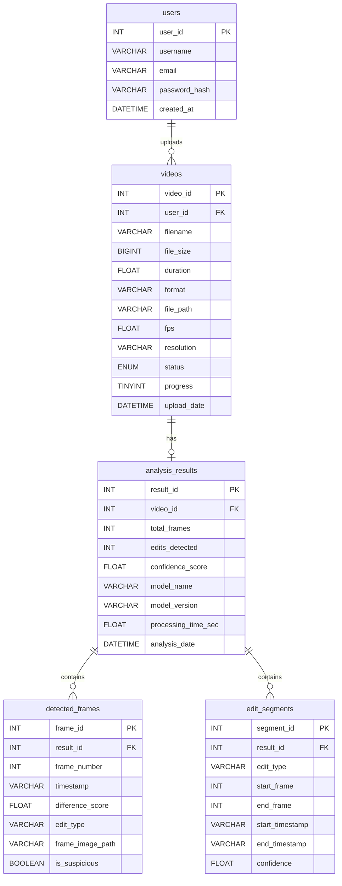

# PHASE 2 AUDIT — Video Edit Detection & Frame Extraction System

> **Date:** 2026-11-10  
> **Scope:** Add a real, trained ML pipeline (`ai-service/`) that replaces all mocked analysis logic.  
> **Constraint:** 1 developer, 7 calendar days. Supervisor requires a **trained model**.

---

## 1. What Is Real vs What Is Mocked

### ✅ Real (working today)

| Layer | What works |
|---|---|
| **React frontend** | Drag-and-drop file picker, upload progress UI, history list with search/filter, analysis results page with charts, database schema page, layout/routing — all functional UI |
| **Express API (`server/`)** | CRUD endpoints (`GET /api/videos`, `GET /api/videos/:id`, `POST /api/videos`, `DELETE /api/videos/:id`, `GET /api/stats`, `GET /api/health`), MySQL connection pool, transactions |
| **MySQL schema** | 4 tables (`users`, `videos`, `analysis_results`, `detected_frames`) with proper FKs and cascade deletes; 6 seeded demo rows |

### 🚨 Mocked / Faked (must be replaced)

| File | Lines | What's faked | Impact |
|---|---|---|---|
| [`upload.tsx`](file:///Users/tahasmacbook/Downloads/frontend%204/src/app/pages/upload.tsx#L69-L98) | 69-98 | **All analysis numbers are `Math.random()`**: `totalFrames`, `editsDetected`, `confidence`, every frame's `frame_number`, `timestamp`, and `difference_score`. Duration is also random. | This is the core fraud — the "analysis" is just random numbers sent to the DB. The actual video **file bytes are never uploaded** to the server. |
| [`upload.tsx`](file:///Users/tahasmacbook/Downloads/frontend%204/src/app/pages/upload.tsx#L58-L66) | 58-66 | Upload progress bar is a **fake timer** (`setInterval` incrementing by 10 every 200ms). Not tied to actual upload or processing progress. | Cosmetic, but must be wired to real progress. |
| [`upload.tsx`](file:///Users/tahasmacbook/Downloads/frontend%204/src/app/pages/upload.tsx#L88-L98) | 88-98 | `uploadVideo()` sends a **JSON body** with fabricated metadata — it never sends the actual video file (no `FormData`, no `multipart/form-data`). | The Express `POST /api/videos` endpoint only receives JSON, never receives the file. |
| [`server/index.js`](file:///Users/tahasmacbook/Downloads/frontend%204/server/index.js#L81-L139) | 81-139 | `POST /api/videos` stores whatever numbers the frontend sends. **No file storage, no file processing, no analysis.** Status is hardcoded to `'completed'` immediately. | The backend is a pass-through for fake data. |
| [`analysis.tsx`](file:///Users/tahasmacbook/Downloads/frontend%204/src/app/pages/analysis.tsx#L77-L81) | 77-81 | Anomaly types (`"Color Inconsistency"`, `"Blur Artifact"`, `"Compression Anomaly"`, `"Frame Duplication"`) are **hardcoded strings** assigned by index modulo — not from any real detection. | Displayed in the Overview tab and bar chart as if they are real. |
| [`analysis.tsx`](file:///Users/tahasmacbook/Downloads/frontend%204/src/app/pages/analysis.tsx#L416-L444) | 416-444 | Technical Details tab has **hardcoded placeholders**: `"Computer Vision CNN"`, `"DeepFake v3.2"`, `"30 FPS"`, `"1920x1080"`, `"65%"` threshold. None come from the DB or real analysis. | Pure display fiction. |
| [`analysis.tsx`](file:///Users/tahasmacbook/Downloads/frontend%204/src/app/pages/analysis.tsx#L453-L458) | 453-458 | Detection techniques list (`"Pixel Difference Analysis"`, etc.) is a **hardcoded array** — all show `"Applied"` regardless. | Cosmetic but misleading. |
| [`analysis.tsx`](file:///Users/tahasmacbook/Downloads/frontend%204/src/app/pages/analysis.tsx#L321-L323) | 321-323 | Frame thumbnails are a **grey placeholder** (`<FileVideo>` icon in a slate box) — no actual extracted frame images are displayed. | No real frame extraction exists. |
| [`schema.sql`](file:///Users/tahasmacbook/Downloads/frontend%204/server/schema.sql#L57-L88) | 57-88 | Seed data includes 6 fake videos with fabricated analysis results and frame detections. | Acceptable for demo, but the demo data shouldn't claim to be real analysis. |

### Summary

> **Nothing in the entire stack performs any actual video analysis.** The video file is never sent to the server. All "analysis results" are `Math.random()` numbers generated in the browser and stored as-is in MySQL. There is no ML model, no OpenCV processing, no frame extraction, and no file storage.

---

## 2. Every "Deepfake" Reference to Remove

Only **one** occurrence exists in the codebase:

| File | Line | Current Text | Replacement |
|---|---|---|---|
| [`analysis.tsx`](file:///Users/tahasmacbook/Downloads/frontend%204/src/app/pages/analysis.tsx#L434) | 434 | `DeepFake v3.2` | `EditDetect v1.0` (or the real model name once trained) |

> No other file, comment, variable name, or database value contains "deepfake" or any variant. This is the only reference to scrub.

---

## 3. Proposed Project Structure

```
frontend 4/                     ← repo root
├── src/                        ← React + Vite frontend (unchanged location)
│   └── app/
│       ├── pages/
│       │   ├── upload.tsx       ← MODIFY: real file upload + polling
│       │   ├── analysis.tsx     ← MODIFY: show real results + frame images
│       │   ├── history.tsx      ← minor: add status column
│       │   └── ...
│       └── lib/
│           └── api.ts           ← MODIFY: new endpoints
│
├── server/                     ← Express API (proxy + DB)
│   ├── index.js                ← MODIFY: file upload, proxy to Flask, status polling
│   ├── uploads/                ← NEW: stored video files
│   ├── schema.sql              ← MODIFY: add new columns
│   └── package.json
│
├── ai-service/                 ← NEW: Python ML service
│   ├── app.py                  ← Flask entry point
│   ├── requirements.txt        ← opencv-python, scikit-learn, torch, torchvision, flask, gunicorn
│   ├── config.py               ← Thresholds, paths, model version
│   ├── models/
│   │   ├── train.py            ← Training script (produces .pt / .pkl)
│   │   └── edit_detector.pt    ← Saved trained model weights
│   ├── pipeline/
│   │   ├── __init__.py
│   │   ├── ingest.py           ← OpenCV: decode video, extract all frames
│   │   ├── features.py         ← Feature extraction (histogram diff, SSIM, optical flow, edge diff)
│   │   ├── predict.py          ← Load model, run inference per frame-pair
│   │   └── segment.py          ← Group flagged frames into edit segments
│   ├── utils/
│   │   ├── __init__.py
│   │   └── video_utils.py      ← FPS detection, duration, resolution helpers
│   ├── extracted_frames/       ← Output: saved frame images (JPGs)
│   └── tests/
│       └── test_pipeline.py
│
├── docs/
│   └── PHASE2_AUDIT.md         ← This document
└── ...
```

### Why this structure?

- **`ai-service/` is a sibling of `server/` and `src/`** — easy to run independently, no coupling.
- **Express acts as the gateway** — the React frontend never talks directly to Flask. Express handles file uploads (`multer`), proxies analysis requests to Flask, stores results.
- **Separation of concerns** — Node handles auth/DB/file storage; Python handles ML only.
- **`models/` contains the trained artefact** — the supervisor can see `train.py` and the saved `.pt` file.

---

## 4. API Contract: React → Express → Flask

### 4.1 Upload Video File

```
React                    Express                      Disk
──────                   ───────                      ────
POST /api/upload         
  Content-Type:          
  multipart/form-data    
  field: "video"         ──► multer saves to           server/uploads/{uuid}.mp4
                              server/uploads/
                         ──► INSERT INTO videos         
                              (filename, file_size,     
                               duration, format,        
                               file_path, status='pending')
                         ◄── { video_id, status }
◄── 201 { video_id }
```

**Express endpoint:**
```
POST /api/upload
Request:  multipart/form-data  { video: File }
Response: 201 { video_id: number, status: "pending" }
```

### 4.2 Start Analysis

```
React                    Express                      Flask (ai-service)
──────                   ───────                      ──────────────────
POST /api/analyze
  { video_id }           ──► UPDATE videos SET          
                              status='processing'
                         ──► POST http://localhost:5050/analyze
                              { video_id, file_path,
                                callback_url }
                         ◄── 202 { job_id }
◄── 202 { job_id }
```

**Express endpoint:**
```
POST /api/analyze
Request:  { video_id: number }
Response: 202 { job_id: string, status: "processing" }
```

**Flask endpoint (internal):**
```
POST /analyze
Request:  { video_id: number, file_path: string, callback_url: string }
Response: 202 { job_id: string }
Side-effect: starts background thread → runs pipeline → POSTs results to callback_url
```

### 4.3 Poll Status

```
React                    Express
──────                   ───────
GET /api/videos/:id/status
                         ──► SELECT status, progress 
                              FROM videos WHERE video_id = :id
◄── 200 { status, progress }
```

**Express endpoint:**
```
GET /api/videos/:id/status
Response: 200 {
  status: "pending" | "processing" | "completed" | "failed",
  progress: number        // 0-100, updated by Flask callback
}
```

### 4.4 Flask Callback (internal — Flask → Express)

When the Python pipeline finishes, it POSTs results back:

```
Flask                         Express
─────                         ───────
POST /api/internal/results
  { video_id, 
    total_frames,             ──► INSERT INTO analysis_results
    edits_detected,           ──► INSERT INTO detected_frames (bulk)
    confidence_score,         ──► INSERT INTO edit_segments (bulk)
    model_name,               ──► UPDATE videos SET status='completed'
    model_version,
    segments: [...],
    frames: [...] }
```

### 4.5 Get Results

```
React                    Express
──────                   ───────
GET /api/videos/:id
                         ──► SELECT video + result + segments + frames
◄── 200 { video, result, segments, frames }
```

**Full response shape:**
```typescript
// GET /api/videos/:id
{
  video: {
    video_id: number;
    filename: string;
    file_size: number;
    duration: number;          // real, from OpenCV
    format: string;
    file_path: string;         // server-side path
    upload_date: string;
    status: "pending" | "processing" | "completed" | "failed";
    progress: number;
    fps: number;               // real, from OpenCV
    resolution: string;        // e.g. "1920x1080"
  };
  result: {
    result_id: number;
    video_id: number;
    total_frames: number;
    edits_detected: number;    // count of detected edit points
    confidence_score: number;  // overall model confidence (0-100)
    model_name: string;        // e.g. "EditDetect"
    model_version: string;     // e.g. "1.0"
    analysis_date: string;
    processing_time_sec: number;
  } | null;
  segments: Array<{            // continuous edit regions
    segment_id: number;
    result_id: number;
    edit_type: string;         // "cut" | "splice" | "insertion" | "deletion" | "duplication"
    start_frame: number;
    end_frame: number;
    start_timestamp: string;   // "00:01:23"
    end_timestamp: string;
    confidence: number;        // 0.0-1.0 for this segment
  }>;
  frames: Array<{              // individual flagged frames
    frame_id: number;
    result_id: number;
    frame_number: number;
    timestamp: string;
    difference_score: number;  // 0.0-1.0
    edit_type: string;         // what kind of edit detected
    is_suspicious: boolean;
    frame_image_url: string;   // "/api/frames/{frame_id}.jpg"
  }>;
}
```

### 4.6 Serve Extracted Frame Images

```
GET /api/frames/:filename
Express serves static files from ai-service/extracted_frames/
```

### Endpoint Summary Table

| Method | Path | Source | Target | Purpose |
|---|---|---|---|---|
| `POST` | `/api/upload` | React | Express | Upload video file (multipart) |
| `POST` | `/api/analyze` | React | Express → Flask | Kick off ML analysis |
| `GET` | `/api/videos/:id/status` | React | Express | Poll processing status |
| `GET` | `/api/videos` | React | Express | List all videos + summaries |
| `GET` | `/api/videos/:id` | React | Express | Full results + segments + frames |
| `DELETE` | `/api/videos/:id` | React | Express | Delete video + results |
| `GET` | `/api/stats` | React | Express | Dashboard counts |
| `GET` | `/api/frames/:filename` | React | Express (static) | Serve extracted frame JPGs |
| `POST` | `/analyze` | Express | Flask | Internal: start analysis job |
| `POST` | `/api/internal/results` | Flask | Express | Internal: deliver results |

---

## 5. Database Schema Changes

### 5.1 ALTER `videos` — add file storage + metadata columns

```sql
ALTER TABLE videos
  ADD COLUMN file_path    VARCHAR(500)   AFTER format,        -- e.g. "uploads/abc123.mp4"
  ADD COLUMN fps          FLOAT          AFTER file_path,     -- from OpenCV
  ADD COLUMN resolution   VARCHAR(20)    AFTER fps,           -- "1920x1080"
  ADD COLUMN progress     TINYINT        DEFAULT 0 AFTER status,  -- 0-100
  MODIFY COLUMN status    ENUM('pending','processing','completed','failed') DEFAULT 'pending';
```

### 5.2 ALTER `analysis_results` — add model info + timing

```sql
ALTER TABLE analysis_results
  ADD COLUMN model_name         VARCHAR(50)  DEFAULT 'EditDetect'  AFTER confidence_score,
  ADD COLUMN model_version      VARCHAR(20)  DEFAULT '1.0'         AFTER model_name,
  ADD COLUMN processing_time_sec FLOAT       DEFAULT 0             AFTER model_version;
```

### 5.3 ALTER `detected_frames` — add edit type + frame image

```sql
ALTER TABLE detected_frames
  ADD COLUMN edit_type       VARCHAR(30)  AFTER difference_score,  -- "cut", "splice", etc.
  ADD COLUMN frame_image_path VARCHAR(500) AFTER edit_type;        -- "extracted_frames/v5_f412.jpg"
```

### 5.4 NEW TABLE `edit_segments` — contiguous edited regions

```sql
CREATE TABLE edit_segments (
  segment_id      INT AUTO_INCREMENT PRIMARY KEY,
  result_id       INT NOT NULL,
  edit_type       VARCHAR(30) NOT NULL,       -- "cut" | "splice" | "insertion" | "deletion" | "duplication"
  start_frame     INT NOT NULL,
  end_frame       INT NOT NULL,
  start_timestamp VARCHAR(20),
  end_timestamp   VARCHAR(20),
  confidence      FLOAT DEFAULT 0,
  FOREIGN KEY (result_id) REFERENCES analysis_results(result_id) ON DELETE CASCADE
);
```

### 5.5 Updated ER Diagram



---

## 6. Day-by-Day Task List (7 Days, 1 Developer)

### Day 1 — ML Pipeline Foundation (Python)

| # | Task | Est. |
|---|---|---|
| 1.1 | Create `ai-service/` folder structure, `requirements.txt`, virtual env | 30 min |
| 1.2 | Write `pipeline/ingest.py`: OpenCV video decode → extract every Nth frame → save as JPG to `extracted_frames/` | 2 hr |
| 1.3 | Write `pipeline/features.py`: for each consecutive frame pair, compute histogram difference, SSIM, mean absolute pixel difference, edge magnitude difference | 3 hr |
| 1.4 | Write `utils/video_utils.py`: get FPS, duration, resolution, total frame count via OpenCV | 30 min |
| 1.5 | Test ingest + features on 2-3 sample videos manually | 1 hr |

**End of Day 1 deliverable:** Can decode any video, extract frames, and compute per-frame-pair feature vectors.

---

### Day 2 — Feature Extraction & Dual Model Training

| # | Task | Est. |
|---|---|---|
| 2.1 | Run dataset generator (`generate_dataset.py`) on source videos → produces labelled dataset + `labels.csv` | 1 hr |
| 2.2 | Implement full feature extractor (`pipeline/features.py`): histogram diff, SSIM, pixel MAD, edge diff, pHash distance, optical flow, ORB match ratio, neighbor-median context | 2.5 hr |
| 2.3 | Write `models/train_rf.py`: train Random Forest baseline on flat feature vectors, tune hyperparameters, output classification metrics | 1.5 hr |
| 2.4 | Write `models/train_temporal.py`: build PyTorch 1D-CNN + BiLSTM model over sliding window sequences $(T=15)$, train with BCE loss, save `temporal_edit_detector.pt` | 2.5 hr |
| 2.5 | Evaluate and compare both models: accuracy, precision, recall, F1, ROC-AUC, latency per 1000 frames. Generate comparative Markdown table for report. | 1.5 hr |

**End of Day 2 deliverable:** Two trained models (`rf_edit_detector.pkl` and `temporal_edit_detector.pt`) with side-by-side benchmark comparison. Model selection flag in config.

---

### Day 3 — Flask API + Prediction Pipeline

| # | Task | Est. |
|---|---|---|
| 3.1 | Write `pipeline/predict.py`: load saved model, run inference on feature vectors, output per-frame-pair edit probability | 1.5 hr |
| 3.2 | Write `pipeline/segment.py`: group consecutive high-probability frames into edit segments, classify segment type based on feature patterns (cut = sudden histogram jump, duplication = near-zero diff, etc.) | 2 hr |
| 3.3 | Write `app.py` (Flask): `POST /analyze` endpoint — receives `{video_id, file_path}`, spawns background thread, runs full pipeline (ingest → features → predict → segment), POSTs results to Express callback | 3 hr |
| 3.4 | Add `POST /health` endpoint and error handling | 30 min |
| 3.5 | End-to-end test: `curl` a video to Flask, verify JSON results | 1 hr |

**End of Day 3 deliverable:** Flask service can accept a video path and return real analysis results with segments + flagged frames.

---

### Day 4 — Express Backend Overhaul

| # | Task | Est. |
|---|---|---|
| 4.1 | Run schema migrations (Section 5 ALTERs + new `edit_segments` table) | 30 min |
| 4.2 | Add `multer` to Express: `POST /api/upload` saves file to `server/uploads/`, inserts `videos` row with `file_path`, returns `video_id` | 2 hr |
| 4.3 | Add `POST /api/analyze`: updates status to `processing`, calls Flask `POST /analyze` with `file_path` and `callback_url` | 1.5 hr |
| 4.4 | Add `POST /api/internal/results`: receives Flask callback, inserts `analysis_results` + `detected_frames` + `edit_segments`, updates `videos.status = 'completed'` | 2 hr |
| 4.5 | Add `GET /api/videos/:id/status`: returns `{status, progress}` | 30 min |
| 4.6 | Add `GET /api/frames/:filename`: static file serve from `ai-service/extracted_frames/` | 30 min |
| 4.7 | Update `GET /api/videos/:id` to JOIN and return `edit_segments` alongside frames | 1 hr |

**End of Day 4 deliverable:** Full Express API works end-to-end with Flask. Can upload, trigger analysis, receive results.

---

### Day 5 — React Frontend Rewrite

| # | Task | Est. |
|---|---|---|
| 5.1 | Rewrite `upload.tsx`: use `FormData` to POST actual file to `/api/upload`, then call `/api/analyze`, then poll `/api/videos/:id/status` for real progress, navigate to analysis page on completion | 3 hr |
| 5.2 | Update `api.ts`: new `uploadFile()`, `startAnalysis()`, `pollStatus()` functions + updated TypeScript interfaces (add `segments`, `frame_image_url`, `edit_type`, etc.) | 1.5 hr |
| 5.3 | Rewrite `analysis.tsx`: display real frame thumbnails (`` instead of grey placeholder), show edit segments in a timeline, show real model name/version/processing time in Details tab, populate anomaly types from actual `edit_type` values | 3 hr |
| 5.4 | Remove the `"DeepFake v3.2"` reference (line 434), replace with dynamic `result.model_name` + `result.model_version` | 15 min |
| 5.5 | Update `history.tsx`: show processing status badge (`pending`/`processing`/`completed`/`failed`) | 30 min |

**End of Day 5 deliverable:** Full UI flow works: upload real file → see processing → view real results with frame images.

---

### Day 6 — Polish, Edge Cases & Testing

| # | Task | Est. |
|---|---|---|
| 6.1 | Handle error states: upload failure, analysis failure, Flask offline, invalid video format | 2 hr |
| 6.2 | Add file size validation (reject >500 MB), format validation in Express | 30 min |
| 6.3 | Add loading skeleton on analysis page while processing | 30 min |
| 6.4 | Update `database.tsx` schema page to reflect new columns and `edit_segments` table | 1 hr |
| 6.5 | End-to-end test with 3+ videos of different formats/lengths, verify results are sensible | 2 hr |
| 6.6 | Update `schema.sql` with full v2 schema + updated seed data | 1 hr |
| 6.7 | Clean up any remaining hardcoded placeholder text across all pages | 1 hr |

**End of Day 6 deliverable:** System is robust, handles errors gracefully, all pages reflect real data.

---

### Day 7 — Documentation, Demo Prep & Buffer

| # | Task | Est. |
|---|---|---|
| 7.1 | Update `README.md` with new architecture diagram, setup steps for all 3 services (frontend, server, ai-service) | 1.5 hr |
| 7.2 | Update `SETUP_GUIDE.md` with Python venv setup, MySQL migration steps | 1 hr |
| 7.3 | Write `ai-service/README.md`: model architecture, training data description, accuracy metrics, how to retrain | 1.5 hr |
| 7.4 | Prepare 2-3 demo videos (one clean, one with obvious cuts, one with subtle edits) to show during evaluation | 1 hr |
| 7.5 | Dry-run the full demo flow: fresh DB → upload → analysis → results → download report | 1 hr |
| 7.6 | **Buffer time** for any spillover from previous days | 2 hr |

**End of Day 7 deliverable:** Everything documented, demo-ready, supervisor can see trained model + real working system.

---

## Key Technical Decisions

### Model Choice: Random Forest Baseline + PyTorch Temporal Model (Both Required)

Per supervisor requirement, we train and compare **two complementary models**:

| Model | Architecture | Input | Strengths |
|---|---|---|---|
| **Model 1: Random Forest (Baseline)** | 100 trees, max_depth=12, balanced class weights (scikit-learn) | Flat feature vector per frame-pair (8 features + neighbor context) | Extremely fast to train, highly interpretable (feature importance), excellent tabular baseline |
| **Model 2: Temporal 1D-CNN / BiLSTM (Primary)** | PyTorch: 2-layer 1D-CNN + 1-layer bidirectional LSTM + linear classification head | Sliding window of $T=15$ frame-pair feature vectors $(B, T, C)$ | Captures **temporal dynamics**: edit boundaries, stutter patterns (frame drops), plateau regions (duplications) across time |

Both models are trained on the same extracted feature sequences and compared side-by-side in Day 2 evaluation (accuracy, precision, recall, F1, inference latency). The comparison provides strong empirical justification for the FYP report.

### Feature Extraction Set (8 Core + Temporal Context)

For every consecutive frame pair $(F_t, F_{t+1})$:

1. **Histogram Difference**: Chi-squared distance across HSV color channels (detects cuts, scene changes).
2. **SSIM (Structural Similarity Index)**: Luminance, contrast, and structure comparison (detects subtle pixel-level edits).
3. **Pixel MAD (Mean Absolute Difference)**: Grayscale absolute difference (raw change magnitude).
4. **Edge Magnitude Difference**: Sobel filter gradient difference (detects boundary and sharpness inconsistencies).
5. **Perceptual Hash (pHash) Distance**: Hamming distance between 64-bit DCT perceptual hashes (robust to re-encoding, sensitive to structural changes).
6. **Optical-Flow Magnitude**: Farneback dense optical flow mean/max magnitude (detects motion jumps, deletion gaps, frame drops).
7. **ORB Feature Match Ratio**: Ratio of matched ORB keypoints between frames (geometric consistency across frames).
8. **Neighbor-Median Context Features**: Ratio of current frame diff to the rolling median of the previous $k=5$ and next $k=5$ frame diffs (normalizes for camera motion vs sudden edits).

### File Upload & Asynchronous Processing

- **Upload via `multer`**: Strict server-side validation (max 500 MB, MIME type allowlist `video/mp4`, `video/quicktime`, `video/x-msvideo`, `video/x-matroska`, `video/webm`).
- **Async Job Pattern**:
  1. `POST /api/upload` streams file to `server/uploads/{uuid}.{ext}`, creates `videos` record (`status='pending'`).
  2. `POST /api/analyze` triggers background worker, sets `status='processing'`, returns immediately with `job_id`.
  3. React polls `GET /api/videos/:id/status` (every 1.5s) displaying real progress (0–100%) computed by the Python pipeline.
  4. On completion (`status='completed'`), frontend navigates to `/analysis/:id`.
  5. Failed jobs set `status='failed'` with error details.

### Edit Types Detected

| Edit Type | Primary Detection Signal |
|---|---|
| **Cut / Scene Change** | Spike in histogram diff + pHash distance + sharp drop in SSIM |
| **Splice / Insertion** | Discontinuity in color distribution + ORB match failure across boundary |
| **Frame Deletion** | Unnatural optical-flow magnitude spike (temporal jump) |
| **Frame Duplication** | Near-zero MAD / SSIM $\approx 1.0$ between non-identical timestamps, flat flow |
| **Frame Dropping** | Periodic stutter in optical flow + elevated neighbor-median ratio |

---

## Risks & Mitigations

| Risk | Likelihood | Mitigation |
|---|---|---|
| Training data is too small for good accuracy | High | Use aggressive augmentation (different cut points, re-encode at different bitrates). Even 60-70% accuracy is acceptable — this is a prototype. |
| Flask + Express integration bugs eat a full day | Medium | Test Flask standalone first (Day 3) before wiring Express. Use simple `fetch()` — no complex queuing. |
| Large videos take too long to process | Medium | Sample every 5th frame instead of every frame. Add a `max_frames` config cap (e.g. 3000). |
| Day 2 model training takes longer than expected | Medium | Feature extraction is modularized and can be parallelized with multiprocessing. Both models are trained on cached feature matrices. |

---

> **Plan Approved.** Proceeding with Day 1 implementation (Dataset Generator & Environment).

